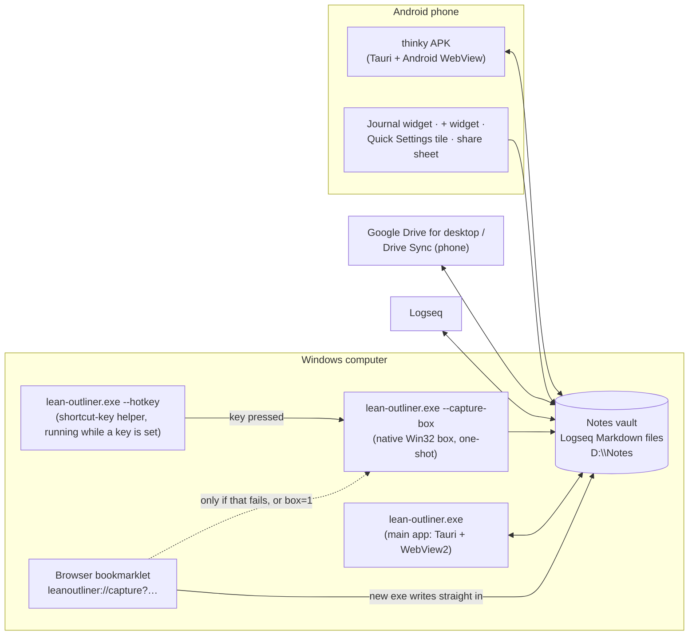

# thinky (Lean Outliner) — architecture map

**Read this first, before building anything new.** It is the top-down map: what programs exist,
what runs in the background on a Windows computer and an Android phone, what the app leaves outside its own folder,
and which file owns which job. `CLAUDE.md` holds the detailed rules and history for each part;
this file tells you which part to look up there.

Written Oct 29, 2026 from `main` at Build 31, then checked line by line against the code by a separate review. When you add or remove a component, a background
process, or a footprint outside the repo, **update this file in the same commit**.

> Name: "thinky" was picked (hand-lettered wordmark) in late Oct 2026, but the screen still
> says "Lean Outliner". The hidden identifiers never change (`com.srikanth.leanoutliner`,
> `leanoutliner://`, cargo `lean-outliner`, repo names), so updates install over old builds.

---

## 1. The big picture

Key idea: **the notes vault is plain Logseq Markdown files, and many writers touch it** (this app,
the capture box, the phone widget, Logseq, sync apps, other tools). The app never assumes
it is the only writer: every save carries the version it started from and merges or shows a clash.

---

## 2. One program, many jobs (Windows)

There is a single executable, `lean-outliner.exe`. What it does depends on how it's started
(`src-tauri/src/main.rs`; real order checked there: `--hotkey`, `--hotkey-selftest`,
`--capture-box-selftest`, `--check`, `--verify-update`, `--capture`, `--capture-box`, a
`leanoutliner://` link, else the app):

| Started as | What it is | Web engine? | Lives in |
|---|---|---|---|
| `--hotkey` | The **shortcut-key helper**. Sits asleep, waits for the capture key, starts `--capture-box`. Started with Windows (installed copy only); quits at once if no key is set (`hotkey.txt` empty). | No | `src-tauri/src/hotkey.rs` |
| `--capture-box` | The **"Add to journal" box** (Spotlight-like). Native Win32 window, appears in ~40–120 ms, adds one note, exits. Uses worker threads (opening the vault read-only for the page list, adding, pasted picture → PNG) and reads the clipboard to pre-fill. | No | `src-tauri/src/capture_box/` (`files.rs`: clipboard, file picker, PNG), rules in `core/src/capture_box.rs` |
| *(web capture box)* | Fallback when the native box can't be made (and on non-Windows): a second Tauri window labelled `capture` (`ui/capture.html/js`), adds via the `quick_capture` command. Its start-up still re-points the link handler, but skips the helper, links and tidy. | Yes | `lib.rs` `run_capture_box` |
| `--capture "text" ["url"]` | Adds a note straight to the journal, no window (opens the box if that fails). | No | `main.rs` → `core/src/capture.rs` |
| `leanoutliner://capture?…` | A browser bookmarklet click. Writes the note straight in (`capture_to_vault`); opens the box only if that fails, or if the link has `box=1` (the shipped bookmarklet never sends it). | No | `core/src/link.rs`, `main.rs` |
| `leanoutliner://page/<name>`, `…/note/<id>` (or any other non-capture `leanoutliner://`, `Link::App`) | Hands the link to the open app and quits; if none is open, starts the app on that page. | Only if it starts the app | `src-tauri/src/links.rs` |
| `--check <vault> <out.json>` | Read-only health check of a vault. | No | `core/src/app.rs` `check_vault` |
| `--verify-update <exe> <sig> <N>` | CI only: would the app accept this installer as build N? | No | `src-tauri/src/update.rs` |
| `--hotkey-selftest <dir>`, `--capture-box-selftest <dir>` | CI only. **Never run on your own computer** (they press keys / use the clipboard). | — | `hotkey/selftest.rs`, `capture_box/selftest.rs` |
| *(no arguments)* | The **main app** window. | Yes (WebView2) | `src-tauri/src/lib.rs` + `ui/` |

On Android there is one app (the APK) plus Kotlin extras (section 4).

---

## 3. What runs in the background (the part new work keeps missing)

### On the laptop, at any moment

| Thing | When it runs | How to spot it | Why it exists |
|---|---|---|---|
| **Shortcut-key helper** `lean-outliner.exe --hotkey` | From Windows start-up while a key is set (installed copy only; exits at once if `hotkey.txt` is empty) | Hidden message-only window, class `LeanOutlinerHotkey`, title `Lean Outliner shortcut key: <key>` (or `… (starting)`) | Windows' own shortcut-key way took ~3 s; this answers in ~0.1 s. Uses 52 KB RAM, no CPU, no polling. |
| **Start-up threads** (inside the main app, every start: `lib.rs` `setup`) | Once per start | — | `hotkey::at_start` (installed copy only) checks and **repairs** the helper: may start one, rewrite the Run value, write `hotkey.txt`, delete the old `.lnk`. `update::tidy` clears an old download. `win::register_link_handler` points `leanoutliner://` at *this* exe. |
| **Link listener** (inside the main app) | While the main window is open | Hidden window class `LeanOutlinerLinks`, title "Lean Outliner links" | Lets a clicked `leanoutliner://page/…` link reach the open app instead of opening a second one. |
| **File watcher** (a thread inside the main app) | While a vault is open | — | Notices `.md` changes in `pages/` and `journals/` (sync apps, the phone, other tools) within ~400 ms and tells the page (`lean-files` event → `rescan`). Windows change notifications / inotify on Android; dot-files ignored. The page *also* rescans when the window regains focus or becomes visible (and polls every 30 s under the dev server). |
| **Safety-copy thread** (inside the main app) | Once, in the background after a vault opens | — | Copies recently changed notes outside the vault (section 5). |
| **Close guard thread** | When the window is closing | — | Gives the page 5 s to save (`lean-close`), then exits anyway. |
| **Update check** (inside the page) | Once at start (skipped if the last answer is under a day old), and from Settings → About. **No timer**: an app left open for days doesn't check again. Laptop and phone. | The check talks to `api.github.com`; "Update now" downloads from `github.com/…/releases/download` (curl.exe on Windows, MainActivity on Android) | Looks for a newer "Build N" on the public releases repo. |

Rules that follow from this:
- **Anything that must react to a key press, a link or a file change already has a home.** Add to
  the helper, the link listener or the watcher instead of starting another background process.
- **Anything that counts "is the app open?" must ignore the helper** (`hotkey::helper_pids`). The
  updater leaves it out; the installer stops it first. A new check that forgets this will think the app is
  always open.
- **Before replacing or removing the exe, stop the helper first** (`hotkey::stop`; the installer
  does it in `src-tauri/windows/hooks.nsh`).
- The helper must stay tiny: no Tauri, no web engine, no timers. Adding work there needs the maintainer's OK.
- **Every start of any copy (installed, portable, test) re-points the link handler to itself**, and
  the installed copy's start re-checks the helper. Keep that in mind when testing an exe on your own computer.

### On the phone

No background service. While the app is open it runs the same watcher and safety-copy threads.
The journal widget refreshes on its own every 30 min (`updatePeriodMillis` 1800000; the "+" widget
never) and when the app pushes new data; everything else runs only when opened.

---

## 4. Components, layer by layer

### `core/` — Rust library `outline_core`: everything that understands notes (no UI, no OS)
| File | Job |
|---|---|
| `app.rs` | `App` (an open vault) and **`dispatch(cmd, args)` = the whole API** the UI calls. Index cache, saving, rename/merge, assets, last-vault. |
| `app/safety.rs`, `app/history.rs`, `app/pictures.rs` | Safety copies · a page's History · finding/binning unused pictures |
| `parse.rs` | Text → blocks, properties, links, tags |
| `vault.rs` | The index: backlinks, tags, properties, to-dos, search, linked/unlinked references |
| `doc.rs` | Split a file into bullets and join back; **untouched bullets come back byte-for-byte** |
| `merge.rs` | Three-way merge when someone else changed the file; clash parts |
| `search.rs` | Ctrl+K search rules (typo-tolerant page names, ranking) |
| `config.rs`, `edn.rs` | Read and edit `logseq/config.edn` in place |
| `date.rs`, `task.rs`, `text.rs` | Date formats · TODO/DOING/SCHEDULED/DEADLINE · link pieces, rename, mentions |
| `capture.rs` | Quick capture: where a note goes and appending it safely |
| `capture_box.rs` | The capture box's platform-free rules (pre-fill, Enter guard, sizes, page list order) |
| `hotkey.rs` | How a key is spelled ("Ctrl+Shift+L") and reading an old `.lnk`'s key |
| `link.rs` | **The only parser** of `leanoutliner://` links |
| `update.rs` | Rules for one-click updates (addresses, signed text) |
| `log.rs` | The problems log |
| `lib.rs` | Module list, `append_bullet` (add one bullet keeping the file's shape), `key` (page-name lookup key) |

### `src-tauri/` — the Tauri 2 shell: OS glue only
| File | Job |
|---|---|
| `main.rs` | Picks the job from the command line (section 2) |
| `lib.rs` | Starts Tauri; **one command `call`** that forwards to `dispatch`, plus a few OS-only commands (`save_asset_path`, `clipboard`, `prefill`, `start_link`, `reveal_file`, `set_shortcut`/`get_shortcut`, `capture_where`, `update_*`, `quick_capture`, `quit`, `platform`). Two shared commands are special-cased there: `rescan` reads files without holding the lock, and `open` also starts the file watcher. The `vault://` protocol that serves pictures. Close waits for saves (`lean-close`). The three start-up threads (section 3). |
| `watch.rs` | File-change watcher |
| `hotkey.rs` | The shortcut-key helper and the app's side of it (`set`, `state`, `at_start`, `stop`) |
| `capture_box/` | Native Win32 capture box (`mod.rs` the window, `ffi.rs` = Windows functions declared by hand, also used by links.rs; `files.rs` clipboard, file picker, picture → PNG; `selftest.rs` CI) |
| `links.rs` | Handing page/note links to the open app |
| `update.rs` | Download, check signature, run the installer (Windows' own `curl.exe` + CNG) |
| `win.rs` | Registry (link handler), the old Start-menu shortcut, clipboard, local time |
| `windows/hooks.nsh` | Installer/uninstaller additions (stop the helper; remove Run value on uninstall) |
| `tauri.conf.json`, `capabilities/default.json` | Window settings, the CSP (no inline scripts), window permissions |

### `ui/` — the page: plain HTML/CSS/ES modules, no framework, no build step
| File | Job |
|---|---|
| `index.html`, `boot.js` | Shell markup; settings applied before first paint |
| `api.js` | **The bridge**: `call(cmd, args)` → Tauri, or HTTP under the dev server; `listen(event)` |
| `app.js` | `App`: start-up, routing, journals/page views, sidebar, top strip, keys, looks list (`SKINS`) |
| `editor.js` | `Outline`: the block editor — typing, undo, selection, saving, clashes, dragging notes |
| `tabs.js` | Tabs and two pages side by side |
| `render.js`, `math.js` | Markdown → HTML for a note · small TeX |
| `search.js`, `commands.js` | Ctrl+K search and the Ctrl+Shift+P command list |
| `popups.js` | Suggestions, `/` menu, date picker, menus, dialogs, hover preview |
| `views.js` | All pages, tags, properties, to-dos |
| `settings.js` | Settings tabs (Notes, Look, Capture incl. bookmarklet + shortcut key, Shortcuts, About/update) |
| `clash.js`, `history.js` | Clash screen · page History |
| `find.js`, `paste.js`, `export.js`, `move.js`, `filedrop.js` | Find/replace · rich paste · copy page as text · move notes between pages · files dropped from Explorer |
| `capture.html`, `capture.js` | The **web** capture box (fallback; adds via `quick_capture`) |
| `calendar.js`, `dom.js` | Month grid · small DOM helpers and icons |
| `skins.css`, `app.css` | Looks are only token values in `skins.css`; `app.css` reads tokens and never names a look |
| `fonts.css`, `fonts/`, `skins/` | Bundled fonts (Inter since Build 31, Plex, Newsreader, Bricolage) · looks' background images |

Tauri events the shell sends the page (`api.js listen`): `lean-files` (files changed), `lean-close`
(window closing: save now), `lean-link` (a link arrived), `tauri://drag-*` (files dropped). On Android,
`MainActivity` fires **DOM** events instead, through `evaluateJavascript` (`lean-update`,
`lean-access`), which the page catches with `document.addEventListener`.

**Browser storage** (WebView2's own data lives in the app folder, section 5): localStorage `vault`
decides which notes folder the app opens (separate from `last-vault.txt`, which is for the capture
paths). Other localStorage keys: `tabs`, `updateCheck`, `skin`, `sideW`, `splitAt`, `wide`,
`linkStyle`, `recentSearches`, `pagesOpts`, `exportOpts` and more (grep `store.get`); sessionStorage:
`tabs`, `dayFolds`, `refFolds`.

### `android/` — added on top of Tauri's generated Android project
`src-tauri/gen/` is **not committed**: CI runs `tauri android init`, then
`scripts/android_overlay.py` copies these in and patches the manifest.
| File | Job |
|---|---|
| `MainActivity.kt` | Window insets, all-files permission, the **`window.LeanAndroid` bridge** (widget config/colours/tasks, bar colours, print, keyboard, shortcuts, updates), app-icon shortcuts, `leanoutliner://` links |
| `kotlin/JournalWidget.kt` | Today's-journal widget, the round "+" widget, and `Journal` — **a Kotlin copy of the append rules** |
| `kotlin/QuickCaptureActivity.kt` | The "Add to journal" pop-up (widgets' "+", share sheet, tile) |
| `kotlin/AddNoteTile.kt` | Quick Settings tile |
| `res/` | Widget layouts and info XML, drawables, the pop-up's layout |
| `release.keystore` | Not in the repo: the signing key is the `ANDROID_KEYSTORE_B64` secret (locked; never replace) |

Android footprint (put in place by `scripts/android_overlay.py`): permissions MANAGE_EXTERNAL_STORAGE,
READ/WRITE_EXTERNAL_STORAGE, INTERNET, VIBRATE, REQUEST_INSTALL_PACKAGES; components JournalWidget,
JournalWidgetService, QuickAddWidget, QuickCaptureActivity, AddNoteTile, UpdateReceiver (class in
`MainActivity.kt`); a SEND filter (text/plain, image/*) for the share sheet and a VIEW filter for
`leanoutliner://`; EmojiCompat's start-up removed. SharedPreferences `lean_widget` (vault, folders,
formats, capture settings, tasks, colours, bar colours); `cacheDir/update-apk`; app-icon shortcuts
re-published at each start.

### `scripts/` and `ci/`
`android_overlay.py` (above) · `android_test.sh` and helpers (the emulator test) · `update_sig.py`
(sign/check updates) · `ci_version.py` (build N → version 0.1.N) · `ci_report.py` (sizes) ·
`make_test_vault.py`. `ci/baseline.json` (agreed sizes), `ci/update-key.pub` (the update key's public half; the
locked keys themselves are secrets, never files in the repo).

### `dev/` — testing without Tauri
`devserver` (`dev/src/main.rs`, hand-written HTTP) serves `ui/` and `POST /api/<cmd>` → the same
`dispatch`. `cargo run -p devserver -- <vault> [port]` (default 8765). `dev/ui-tests/`: 28 Playwright
tests (smoke + t1…t15), `run.sh` runs them all.

---

## 5. Footprints outside the repo (what the app leaves on a computer)

**Windows registry (per user, HKCU):**
- `Software\Microsoft\Windows\CurrentVersion\Run` → value `Lean Outliner shortcut key` =
  `"<exe>" --hotkey` (starts the helper with Windows).
- `Software\Classes\leanoutliner` (default "URL:Lean Outliner", "URL Protocol") and
  `…\shell\open\command` = `"<exe>" "%1"` (the link handler). **Every start of any copy — installed,
  portable, test, even the web capture box — re-points this to itself.** After testing an exe, put it
  back to `"C:\Users\you\AppData\Local\Lean Outliner\lean-outliner.exe" "%1"`.

**Start menu:** `%APPDATA%\Microsoft\Windows\Start Menu\Programs\Lean Outliner capture.lnk` — the
*old* way to get a shortcut key (made by spawning PowerShell/WScript.Shell). The installed copy
removes it once the helper holds the key; the portable copy still uses it.

**Named things Windows knows about:** mutex `Local\LeanOutlinerHotkeyStart`; hidden windows
`LeanOutlinerHotkey` ("Lean Outliner shortcut key: <key>"), `LeanOutlinerLinks` ("Lean Outliner
links"), `LeanOutlinerCaptureBox` (the box, plus a hidden owner window "Lean Outliner capture"; a
second box finds the first by class + title and hands it its words by WM_COPYDATA).

**Installed program:** `C:\Users\you\AppData\Local\Lean Outliner\` (per-user installer,
`installMode: currentUser`). Tauri's default NSIS installer also adds its own uninstall entry and
shortcuts — Tauri's behaviour, not code in this repo; not yet checked on the laptop.

**App folder** `%LOCALAPPDATA%\com.srikanth.leanoutliner\` (Android: the app's private cache/data):
| File | Written by | Read by |
|---|---|---|
| `last-vault.txt` | the app when a vault opens (`remember_vault`) | capture box, `--capture`, bookmarklet, `capture_where`, `quick_capture` (they add to this vault **without** the app open) |
| `hotkey.txt` | Settings → Capture → Save/Remove (Remove writes it empty); also `at_start`'s `ensure` (moves an old `.lnk` key over) | the helper at start (empty = off) |
| `hotkey-status.txt` | the helper when it can't take the key | Settings (shows why + Try again) |
| `look.txt` | the app when the look changes (`save_look`) | the native capture box (its colours) |
| `vault-<hash>.json` | index cache: on hide/quit, after ≥20 outside changes, after rename/merge/delete, and at start when earlier texts were kept | app start (only changed files re-read) |
| `problems.log` | anything that fails | Settings → About |
| `safety-copies/vault-<hash>/…` | the safety thread, and `keep_replaced` right before each cache write (earlier texts) | Settings → Safety copies, History |
| `update/` (Android: `cacheDir/update-apk`) | the updater | the updater (old ones tidied after 10 min) |
| WebView2 data (localStorage etc.) | the web engine | the page (section 4, "Browser storage") |

**Inside the vault** (all Logseq-compatible): `logseq/bak/` (backups/History), `logseq/.recycle/`
(the bin — nothing is ever deleted), `assets/` (pictures), `logseq/config.edn` (edited in place).
Short-lived temp files next to the files they replace: `.<file>.<pid>-<n>.tmp` (saves; ones over a
day old are removed on the first save into a folder), `.rename-<pid>.tmp`, Android's
`.capture-*.tmp`; `.list.tmp` in a safety copy. The watcher ignores dot-files, so they never show.

---

## 6. How the main pieces talk

- **A request:** page → `api.js call(cmd, args)` → Tauri `call` (`lib.rs`) → `dispatch` (`core/app.rs`)
  → JSON back. Under the dev server the same `dispatch` is reached over HTTP. So **a new feature that
  only needs notes logic goes in `dispatch`, and works in the app, on Android and in UI tests at once.**
  Only things that need the OS (files dropped, clipboard, registry, links, updates) go in `lib.rs`.
- **A save:** `save` sends the edited doc + `base_hash` (the version it started from). If the file
  changed meanwhile, `merge.rs` merges note by note, or the clash screen opens. Writes go to a temp
  file then rename. Never silently overwrite.
- **A change made elsewhere:** watcher → `lean-files` → page calls `rescan` → index updated →
  open pages catch up (merging with any typing).
- **Pictures:** `vault://localhost/assets/x.png` → `lib.rs` protocol → file in the vault.

---

## 7. Every way a note can be added (capture paths)

All of these end in "append one bullet to today's journal (or a chosen page) without clobbering
anyone else's change".

| Entry point | Code path |
|---|---|
| Shortcut key on the laptop | helper → `--capture-box` → native box → `capture::capture_to_usual` or `App::capture_to_page` (both via `capture::append_note`) |
| Browser bookmarklet (Settings → Capture) | `leanoutliner://capture?url&title&text` → `main.rs` → `capture::capture_to_vault` straight in; the box only if that fails (or a link with `box=1`, which the bookmarklet doesn't send) |
| `--capture "text" "url"` | `main.rs` → `capture_to_vault` (box if it fails) |
| Web capture box (fallback) | `ui/capture.js` → `quick_capture` (`lib.rs`) → `capture_to_vault` |
| Inside the app | Ordinary editing: the phone "+" → `App.addNote` → `Outline.addAtEnd`, saved like any note. (`dispatch` also has `capture` / `append_journal` commands, but no UI uses them; only tests do.) |
| Phone widget "+", share sheet, Quick Settings tile | `QuickCaptureActivity` → Kotlin `Journal.append` |

**Planned:** browser highlights collected per article into one page named after the article, under a
`[[date]]` bullet per visit. The natural starting point is the bookmarklet → `link.rs` →
`capture.rs` path above (a new link kind, or richer `capture` parameters) — not a new background
program.

---

## 8. Rules that live in more than one place (keep them in step)

The same note-format rules exist in **two** codebases. Change one → change the others:
1. Rust `core/` (`append_bullet` in `lib.rs`, `capture.rs`, `file_stem_for`, `asset_file_name`, dates, config)
2. Kotlin `android/kotlin/JournalWidget.kt` (`Journal.append` ≈ `append_bullet` + the 3-try check,
   `saveAsset` ≈ `asset_file_name`, `fileStem` ≈ `file_stem_for`, `Journal.fill`/`splitUrl` ≈
   `capture::fill`/`split_url`, `Journal.format` ≈ `date.rs`). **Not a full mirror:** Kotlin's
   `captureTarget` finds the quick-capture page by file name only (capitals ignored) — no `title::`
   or alias lookup like the Rust side.

Other pairs that must match:
- **Installer ↔ Rust:** `src-tauri/windows/hooks.nsh` hard-codes the class `LeanOutlinerHotkey`, the
  Run value name and the `.lnk` path; they must match `hotkey.rs` (`CLASS`, `RUN_VALUE`) and `win.rs`.
- `ui/api.js` `pageLinkUrl`/`noteLinkUrl` build the links `link.rs` parses.
- `look.txt`: written from `lookColors` (app.js) via `save_look`, read by `core/src/capture_box.rs`.

Also mirrored: `search.rs` `fold` ↔ `ui/search.js`; the bookmarklet text (`settings.js`) ↔ `link.rs`.

---

## 9. Checklist before building a new component

1. **Does something here already do it?** Re-read sections 2, 3 and 7. Background work → the
   helper, link listener or watcher. Notes logic → `dispatch`. Capture → the capture paths.
2. **Lean first.** A new library, bundled asset, startup work or background process: tell the maintainer the
   size/memory cost and get a yes. CI warns past 10% over `ci/baseline.json`.
3. **Does it count running copies, replace the exe, or touch the registry/Start menu?** Account for
   the helper (`helper_pids`, `stop`) and the link handler.
4. **Does it write notes?** Go through `base_hash` / `append_note`; keep files byte-for-byte; update
   the Kotlin mirror.
5. **Windows-only?** Guard it (`#[cfg(windows)]`, `isApp && !isAndroid` in the page).
6. **Tests:** core logic → `cargo test -p outline_core`; UI → `dev/ui-tests/run.sh`; Android →
   `[android-test]` in a commit message; Windows-only native parts → a self-test in CI. Never test
   against a real notes folder; the capture box always writes to the real one.
7. **Update this file and `CLAUDE.md`** in the same commit.

---

## 10. Build, release, CI (short)

- Push to `main` = a public release "Build N" (Windows installer + portable exe, Android APK) on
  `srikanth-iyer/lean-outliner-releases`. Commits touching only Markdown, `ci/baseline.json`, `dev/**` or the phone-test scripts don't build (`paths-ignore` in build.yml; the phone test has no such list, so `[android-test]` still runs it). `wip/**` branches
  build without publishing — use them to check compiling. Build minutes are limited: batch features.
- Jobs in `.github/workflows/build.yml`: `number`, `test`, `update-key`, `windows` (also runs both
  self-tests), `capture-shots`, `android`, `sign` (main, after approval), `sign-wip`, `verify`, `sizes`,
  `release` (main). Pull requests: `pr.yml`. Phone
  emulator test: `android-test.yml`.
- Signing keys (the `release` environment's secrets; see CLAUDE.md) are made once and **never replaced**
  — installed apps would refuse every update.

---

## Glossary (plain words)

- **Tauri** — the toolkit that wraps a web page (`ui/`) in a real desktop/phone app, with Rust code behind it.
- **WebView2** — the Edge-based web engine Windows apps use to show web pages inside a window.
- **Rust crate / workspace** — a Rust library or program (`core`, `src-tauri`, `dev`); the workspace builds them together.
- **dispatch** — the single function that answers every request from the page, by name.
- **Message-only window** — an invisible Windows "window" used just to receive messages (here: "quit" or a link).
- **Registry Run key** — the Windows list of programs to start when you log in.
- **CSP** — the page's safety rules about what it may load (no inline scripts here).
- **CI** — GitHub Actions: GitHub's machines that build, test and publish each push.
- **Vault** — the folder of notes (Logseq calls it a graph).
- **base_hash** — a fingerprint of the file as it was when editing began, so the app can tell if someone else changed it.
